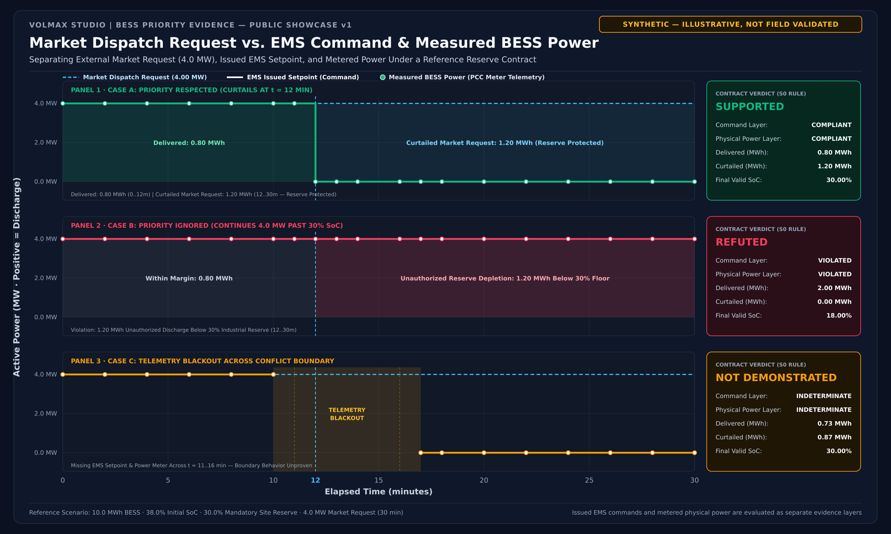

# `bess-priority-evidence-showcase` (Public Showcase v1)

> **`SYNTHETIC — ILLUSTRATIVE, NOT FIELD VALIDATED`**  
> Copyright © 2026 VolMax Studio. All rights reserved.

---

## The Industrial Engineering Question

> *"I operate a Battery Energy Storage System (BESS) to protect an industrial facility's minimum operational reserve while also participating in electricity markets. When those two obligations collide, can operational records establish which priority the controller actually respected — or reveal when the records prove a breach or fail to support either conclusion?"*

Consider an idealized **`10.0 MWh`** industrial BESS starting at **`38.0%`** State of Charge (SoC) with a **`30.0%`** mandatory site reserve floor (`3.00 MWh`) and a continuous **`4.0 MW`** external market dispatch request over **`30 minutes`**:

- Available usable margin above the protected site reserve is **`0.80 MWh`** (`38.0% -> 30.0%`).
- At `4.0 MW`, that margin is exhausted at **minute `12.0`**.
- From `t = 12` to `t = 30 minutes`, the site reserve contract requires stopping market discharge (`1.20 MWh` curtailed market demand) so the industrial reserve stays intact.

---

## Market Dispatch Request vs. EMS Command & Measured Physical Power

---

## Three Bounded Evidence Outcomes (Separated Command & Physical Layers)

| Reference Case | Synthetic Scenario Summary | EMS Command Layer | Physical / Measurement Layer | Priority-Contract Verdict |
| --- | --- | --- | --- | --- |
| **Case A** | EMS curtails market dispatch (`4.00 -> 0.00 MW`) at `t = 12 min`; metered power drops to `0.00 MW` and BMS SoC holds at `30.00%` (`0.80 MWh` delivered, `1.20 MWh` curtailed) | `COMPLIANT` | `COMPLIANT` | **`SUPPORTED`** |
| **Case B** | EMS maintains `4.00 MW` discharge command past `t = 12 min`; metered power continues at `4.00 MW` and BMS SoC depletes to `18.00%` (`1.20 MWh` below the `30.0%` floor) | `VIOLATED` | `VIOLATED` | **`REFUTED`** |
| **Case C** | Valid records up to `t = 10 min` (`31.33%` SoC; 11 valid 1-minute intervals accounting for 0.73 MWh delivered and 0.87 MWh curtailed) and from `t = 17..30 min` (`30.00%` SoC), while EMS setpoint and power telemetry are missing across `t = 11..16 min` spanning the `t = 12 min` boundary | `INDETERMINATE` | `INDETERMINATE` | **`NOT_DEMONSTRATED`** |

---

## Why Command and Physical Layers Must Be Evaluated Separately

A control-system audit cannot equate an issued command with physical plant compliance — and cannot equate a policy breach verdict with a single failure mode:

- **`SUPPORTED`** requires **both** compliant EMS commands and compliant physical measurements across complete, energy-consistent records for the full decision window.
- **`REFUTED`** means the **contracted priority rule was violated** in the deterministic synthetic record — which does not exclusively imply physical battery depletion below the reserve floor. For example:
  - If the EMS issues a `4.0 MW` discharge command at `30.0%` SoC while an external breaker holds metered discharge at `0.0 MW` (`Command Layer: VIOLATED`, `Physical Power Layer: COMPLIANT`), the priority-contract verdict is still **`REFUTED`** because the controller violated its dispatch priority rule.
  - Conversely, if the EMS commands `0.0 MW` while physical discharge continues below `30.0%` SoC (`Command Layer: COMPLIANT`, `Physical Power Layer: VIOLATED`), the contract verdict is **`REFUTED`** because a compliant setpoint never proves physical reserve protection.
- **`NOT_DEMONSTRATED`** means critical command or telemetry records are missing or mutually inconsistent during the conflict window, so neither compliance nor violation can be established from the available records.

---

## Explicit Scope Statement

> **VolMax S0 demonstrates verification of deterministic synthetic BESS records against a predefined priority contract. The verifier separates command-layer and measured physical indicators and returns `SUPPORTED`, `REFUTED`, or `NOT_DEMONSTRATED` within the boundaries of that contract. This demonstration does not represent field validation of an operational EMS.**

See [`SCOPE_AND_EVIDENCE_BOUNDARIES.md`](SCOPE_AND_EVIDENCE_BOUNDARIES.md) for the full evidence boundary and non-claims table.

---

## Governance & Engagement

This showcase publishes the bounded problem formulation, reference visual comparison, and evidence-layer outcomes from VolMax Studio's internal S0 demonstration work (which underwent an internal read-only engineering review and disclosure review). Verification reproducibility was documented across reference test environments internally, but the underlying implementation, generator scripts, exact tolerance parameters, and full reproduction package are intentionally not publicly disclosed to protect proprietary verification methods. Controlled technical reviews are available upon request; no external certification or field validation is claimed.

For industrial BESS owners, commissioning engineers, or technical advisors interested in reviewing operational SCADA/EMS/BMS logs during FAT/SAT or post-commissioning investigations, please contact **VolMax Studio** directly for a scoped technical walkthrough under mutual confidentiality.
