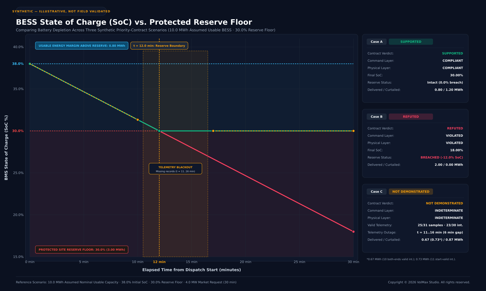
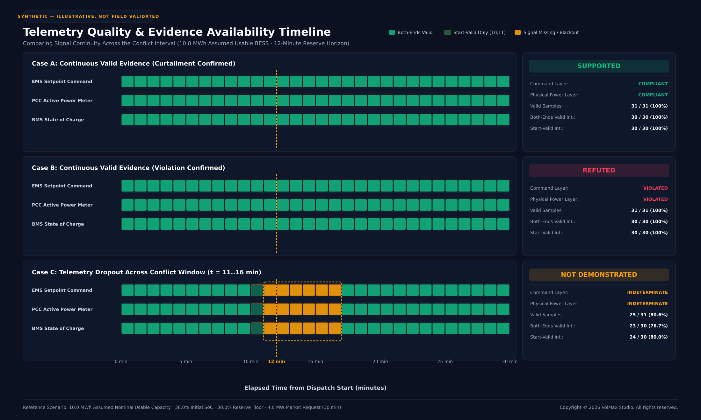

# BESS Engineering Evidence Casebook (Public Showcase v1.1)

> **`SYNTHETIC — ILLUSTRATIVE, NOT FIELD VALIDATED`**  
> Copyright © 2026 VolMax Studio. All rights reserved. No open-source license is granted.

---

## The Industrial Engineering Question

> *"An industrial facility operates a 10 MWh Battery Energy Storage System (BESS) to guarantee an uninterrupted 30% site reserve floor while also bidding into electricity markets. When an external market dispatch request demands power that exceeds available margin above reserve, can operational SCADA/EMS/BMS records prove whether the priority contract was respected — or establish when the records prove a breach or fail to support either conclusion?"*

Consider an idealized **`10.0 MWh`** (assumed nominal usable capacity) industrial BESS starting at **`38.0%`** State of Charge (SoC) with a **`30.0%`** mandatory site reserve floor (`3.00 MWh`) and a continuous **`4.0 MW`** external market dispatch request over **`30 minutes`**:

- Available usable margin above the protected site reserve is **`0.80 MWh`** (`38.0% -> 30.0%`).
- At `4.0 MW`, that margin is exhausted at **minute `12.0`** ($\frac{0.80\text{ MWh}}{4.0\text{ MW}} \times 60 = 12.0\text{ min}$).
- From `t = 12.0` to `t = 30.0 minutes`, the site reserve contract requires stopping market discharge (`1.20 MWh` curtailed market demand) so the industrial reserve stays intact.

This casebook demonstrates how deterministic verification evaluates **synthetic reference telemetry traces** against a predefined priority contract across three canonical scenarios (without executing a live operational EMS controller).

---

## Visual Casebook Overview

### Figure 1 — State of Charge (SoC) vs. Protected Reserve Floor
Shows the conflict geometry at minute 12.0 across three synthetic reference traces: Case A holds strictly at the reserve floor, Case B depletes into the reserve, and Case C enters a telemetry blackout.

---

### Figure 2 — Market Dispatch Request vs. EMS Command & Measured Power
Separates the external market request ($4.0\text{ MW}$), the synthetic EMS setpoint trace, and the modeled PCC active power trace across the three piecewise-constant 1-minute scenarios.

---

### Figure 3 — Telemetry Quality & Evidence Availability Timeline
Evaluates signal continuity across time, illustrating why missing telemetry across the 12-minute transition prevents either a compliance or a breach verdict.

---

## Three Detailed Engineering Case Studies

Explore the detailed synthetic trace analyses, layer breakdowns, and commissioning implications:

| Case Study | Synthetic Reference Trace Summary | Command Layer | Physical Layer | Telemetry | Priority Verdict |
| :--- | :--- | :---: | :---: | :---: | :---: |
| [**Case Study A**](cases/CASE_A_SUPPORTED.md) | Synthetic EMS command trace steps from `4.0 MW` to `0.0 MW` at `t = 12 min`; modeled metered export drops to `0.0 MW` and SoC holds at `30.0%` (`0.80 MWh` delivered, `1.20 MWh` curtailed). | `COMPLIANT` | `COMPLIANT` | Continuous (`31/31`) | **`SUPPORTED`** |
| [**Case Study B**](cases/CASE_B_REFUTED.md) | Synthetic EMS command trace remains at `4.0 MW` past `t = 12 min`; modeled metered export continues at `4.0 MW` and SoC depletes to `18.0%` (`1.20 MWh` below the `30.0%` floor). | `VIOLATED` | `VIOLATED` | Continuous (`31/31`) | **`REFUTED`** |
| [**Case Study C**](cases/CASE_C_NOT_DEMONSTRATED.md) | Valid telemetry for $t = 0..10\text{ min}$ (`0.67 MWh` modeled across `10` both-ends valid intervals; `0.73 MWh` start-sample accounting); telemetry blackout at $t = 11..16\text{ min}$; valid telemetry resumes at $t = 17\text{ min}$ (`30.0%` SoC). | `INDETERMINATE` | `INDETERMINATE` | `25/31` samples (`23/30` valid intervals) | **`NOT_DEMONSTRATED`** |

---

## Why Command and Physical Layers Must Be Evaluated Separately

A rigorous control-system audit cannot equate an issued setpoint command with physical plant compliance — and cannot equate a contract breach verdict exclusively with physical battery over-discharge:

- **`SUPPORTED`** requires **both** compliant EMS command records and compliant physical measurement records across complete, energy-consistent telemetry for the full decision horizon.
- **`REFUTED`** means the **contracted priority rule was affirmatively violated** in the evaluated record:
  - If a recorded EMS setpoint commands `4.0 MW` discharge at `30.0%` SoC while an external breaker holds metered discharge at `0.0 MW` (`Command: VIOLATED`, `Physical: COMPLIANT`), the verdict is **`REFUTED`** because the command layer violated the priority rule.
  - Conversely, if a recorded EMS setpoint commands `0.0 MW` while metered discharge continues below `30.0%` SoC (`Command: COMPLIANT`, `Physical: VIOLATED`), the verdict is **`REFUTED`** because a setpoint never substitutes for physical reserve protection.
- **`NOT_DEMONSTRATED`** means critical command or telemetry records are missing or mutually inconsistent during the conflict interval, so neither compliance nor breach can be established from the records.

---

## Core Technical Reference Documents

1. [**`ENGINEERING_BRIEF.md`**](ENGINEERING_BRIEF.md): Mathematical conflict geometry, market-request energy allocation, and practical FAT/SAT commissioning checklists for BESS engineers.
2. [**`EVIDENCE_AND_REPRODUCIBILITY.md`**](EVIDENCE_AND_REPRODUCIBILITY.md): Internal reference execution baseline, intellectual property boundaries, and controlled verifier demonstration protocol.
3. [**`SCOPE_AND_EVIDENCE_BOUNDARIES.md`**](SCOPE_AND_EVIDENCE_BOUNDARIES.md): Formal evidence boundaries and explicit non-claims.

---

## Governance & Controlled Demonstrations

This showcase publishes the analytical case studies, reference visual comparisons, and evidence-layer outcomes from VolMax Studio's internal S0 demonstration work. Proprietary verification software, synthetic generators, exact numeric tolerance parameters, and raw time-series datasets remain inside VolMax Studio's private assurance vault.

For industrial BESS owners, commissioning engineers, EPCs, or technical advisors interested in evaluating this assurance approach for FAT/SAT or post-commissioning reviews, VolMax Studio can arrange a controlled demonstration of verifier execution under separate written agreement:

📧 **VolMax Studio** — [`volmax.core@gmail.com`](mailto:volmax.core@gmail.com)
